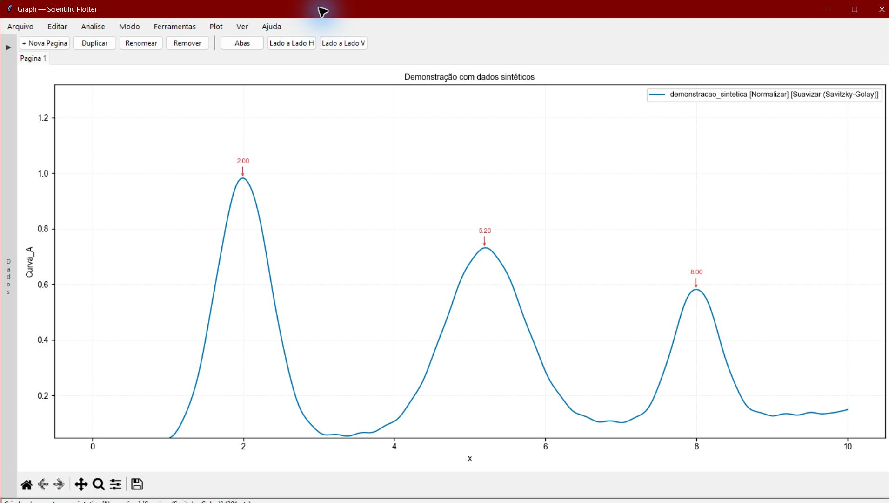
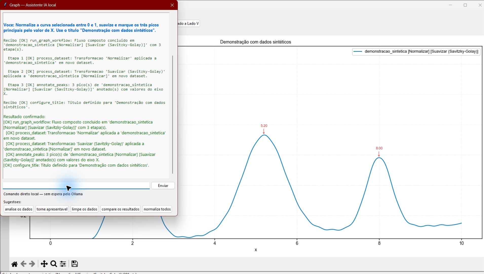

# Graph

**In development** 
Earliest local record: May 8, 2026 · Last recorded update: September 4, 2026 
Presentation updated on November 17, 2026.

I want scientific data work to feel more intuitive: import a measurement, try a transformation, understand the change and prepare a figure in one environment. Graph aims to bring together a broad analysis and plotting toolset, comparable in scope to established scientific software, with AI integrated into the workflow. That breadth is a development goal, not a claim of completed feature parity.

[Português](README.md) · [Portfolio](https://github.com/EagleKhan0505)

## One request, three visible operations

> Normalize the selected curve between 0 and 1, smooth it and label the three main peaks by their X values. Use the title “Demonstration with synthetic data”.

The Portuguese version of this request was executed through the application on **November 17, 2026**, using the first curve in this [synthetic CSV](demo/demonstracao_sintetica.csv). Graph created derived datasets, applied Savitzky–Golay smoothing, annotated three peaks and updated the title. This sample was created for the demonstration and contains no research measurements.

See the request and execution receipts

This request was recognized by the direct local command executor, without waiting for Ollama. It demonstrates a natural-language workflow, not a new model-inference test. The [demonstration notes](demo/LEIA-ME.md) include the original request and scope.

## An analysis workspace that stays editable

Graph imports tabular and instrument data, compares series and organizes figures into pages. Its tools include normalization, smoothing, baseline removal, differentiation, integration, peak detection and curve fitting. Axes, legends and appearance can be edited in the interface.

My interest is in bringing those operations closer to the analyst's intent. I may know what I need to do with a curve, while the practical work is spread across menus, scripts and repetitive adjustments. The integrated assistant helps connect those steps while retaining the direct editing tools.

## Results that can be inspected

Transformations create derived datasets, with undo/redo history. The assistant acts through validated tools and reports the operations that ran. Model-based requests use local Ollama; recognized commands can follow a direct execution path, as in this demonstration.

The curve, derived data and execution record provide something to inspect beyond the assistant's prose. Scientific interpretation and parameter selection still require the analyst's judgment.

**Implementation:** Python, NumPy/Pandas, Matplotlib, Tkinter and Ollama integration. Interface refinement and validation across workflows are ongoing.

The screenshots, walkthrough and synthetic sample are public. The full application and research data remain private.
