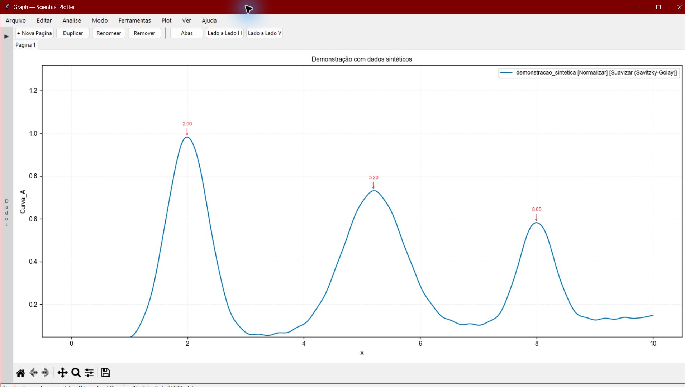
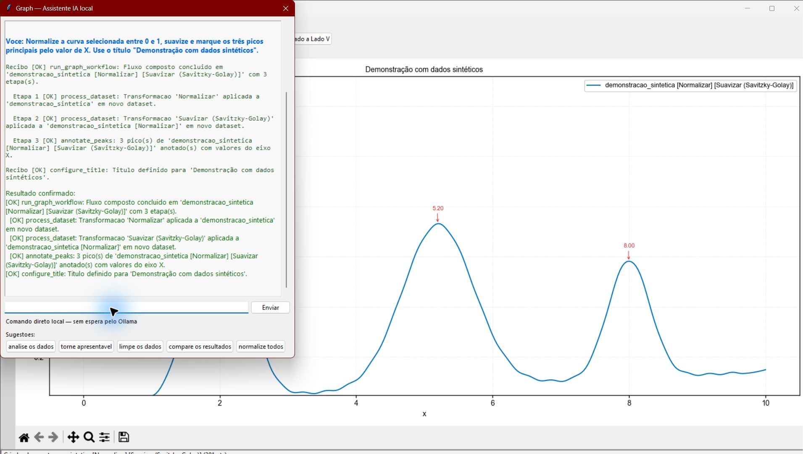

# Graph

Quero que trabalhar com dados científicos seja mais intuitivo: importar uma medida, experimentar um tratamento, entender o que mudou e preparar uma figura no mesmo ambiente. A ideia do Graph é reunir uma capacidade de análise e plotagem tão abrangente quanto a dos softwares usados nesse trabalho, com IA integrada à operação. Essa abrangência é a direção do projeto, ainda em desenvolvimento.

[English](README.en.md) · [Portfólio](https://github.com/EagleKhan0505)

## Um pedido, três operações visíveis

> Normalize a curva selecionada entre 0 e 1, suavize e marque os três picos principais pelo valor de X. Use o título “Demonstração com dados sintéticos”.

Esse pedido foi executado na interface em **17/11/2026**, usando a primeira curva do [CSV sintético disponível aqui](demo/demonstracao_sintetica.csv). O programa criou as transformações, aplicou suavização Savitzky–Golay, anotou três picos e atualizou o título. A amostra foi criada para a demonstração e não contém medições de pesquisa.

Ver o pedido e os registros das operações

Neste caso, o pedido foi reconhecido pelo executor direto de comandos locais, sem aguardar o Ollama. A captura demonstra a execução do fluxo em linguagem natural; não é um teste novo de inferência do modelo. [Passos e limites da demonstração](demo/LEIA-ME.md).

## Uma bancada de análise que continua editável

O Graph importa dados tabulares e formatos de instrumentos, permite comparar séries e organizar figuras em páginas. Há ferramentas para normalização, suavização, remoção de linha de base, derivada, integração, identificação de picos e ajustes de curvas. Eixos, legenda e aparência também podem ser ajustados pela interface.

O ponto que mais me interessa é aproximar essas operações da intenção de quem está analisando. Às vezes sei o que preciso fazer com a curva, mas o trabalho se espalha entre menus, scripts e ajustes repetitivos. O assistente integrado serve para encadear essas tarefas, mantendo as ferramentas de edição disponíveis.

## O resultado precisa poder ser conferido

As transformações geram novos conjuntos de dados, e o programa mantém histórico para desfazer e refazer operações. O assistente trabalha por ferramentas validadas e apresenta registros do que foi executado. O caminho com modelo usa Ollama local; comandos reconhecidos diretamente podem seguir pelo executor sem uma chamada ao modelo, como na demonstração acima.

Essa separação evita depender de uma explicação textual da IA para saber se algo mudou: a curva, os dados derivados e o registro da ação ficam no aplicativo. A interpretação científica e a escolha de parâmetros continuam exigindo critério de quem analisa.

**Base técnica:** Python, NumPy/Pandas, Matplotlib, interface Tkinter e integração com Ollama. O projeto ainda passa por refinamento de interface e validação dos diferentes fluxos; não apresento equivalência completa com um software comercial como resultado alcançado.

As imagens, o roteiro e a amostra sintética estão públicos. O código completo e os dados de pesquisa permanecem privados.
