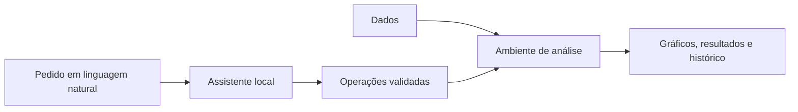

# Graph

**Análise e plotagem de dados com IA integrada ao fluxo de trabalho.**

[English](README.en.md) · [Gustavo Amaral](https://github.com/EagleKhan0505)

## A ideia

Quero construir uma ferramenta de análise e plotagem com uma amplitude de recursos comparável à dos softwares de mercado, integrada à IA para tornar o trabalho mais intuitivo. Essa é a direção do desenvolvimento: aproximar o que quero fazer com os dados das ferramentas necessárias para executar a tarefa.

O Graph reúne gráficos, transformações, ajustes e um assistente local no mesmo ambiente. A integração permite descrever operações em linguagem natural e acompanhar as ações realizadas sobre os dados.

## O que já faz parte do projeto

- Importação de formatos tabulares e científicos, incluindo CSV, Excel e arquivos de DRX.
- Gráficos com múltiplas séries e páginas, controle de eixos, legendas e estilos.
- Normalização, suavização, linha de base, derivadas, integração, detecção de picos e ajustes de curvas.
- Exportação de figuras e dados, além de sessões salvas em formato próprio.
- Histórico de operações, desfazer/refazer e preservação do conjunto original em fluxos de transformação.
- Assistente de IA local que solicita operações por ferramentas com parâmetros validados.

## Minha contribuição

Defino os requisitos a partir das dificuldades que encontro no trabalho com dados científicos. Conduzo o desenvolvimento com apoio de IA, reviso o comportamento das ferramentas e uso exemplos e testes para orientar as melhorias de análise, interface e integração.

## Estado atual

Aplicação local em evolução, com análise, plotagem e integração com Ollama implementadas. A abrangência equivalente à de uma suíte comercial é um objetivo de desenvolvimento; o foco atual é ampliar os recursos mantendo operações compreensíveis e resultados verificáveis.

**Tecnologias:** Python, NumPy, pandas, Matplotlib, Tkinter e Ollama.

Este repositório apresenta o projeto. A implementação completa e os dados de pesquisa permanecem privados.
